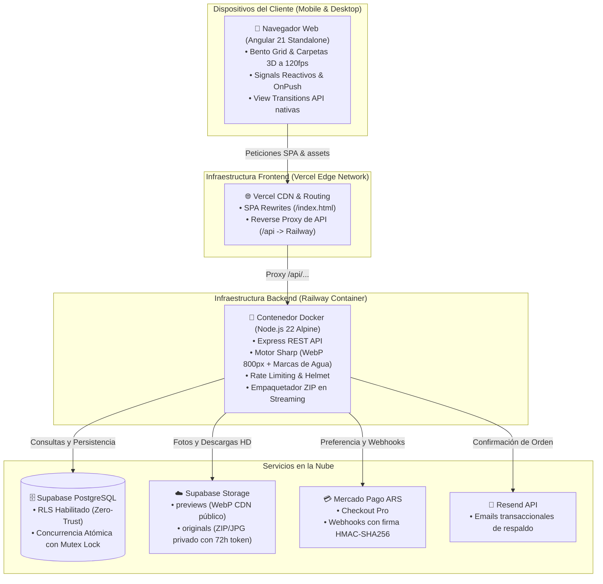

<div align="center">

  # 📸 LA TERCERA
  ### Plataforma E-Commerce & Portfolio de Fotografía Deportiva y Eventos
  **La Rioja Capital, Argentina • Por Jenifer "Yuyo" Espeche**

  [](https://angular.dev/)
  [](https://nodejs.org/)
  [](https://www.typescriptlang.org/)
  [](https://supabase.com/)
  [](https://www.mercadopago.com.ar/)
  [](https://www.docker.com/)
  [](https://railway.com/)
  [](https://vercel.com/)
  [](https://vitest.dev/)

  <p align="center">
    <a href="https://la-tercera.vercel.app">🌐 <b>Explorar Catálogo en Producción</b></a> •
    <a href="https://laterceralr.up.railway.app/api/health">⚡ <b>Estado de la API en Railway</b></a> •
    <a href="https://www.instagram.com/la.tercera.es/">📸 <b>Instagram Oficial</b></a>
  </p>

</div>

---

## 📖 Acerca de La Tercera

**LA TERCERA** es una plataforma web e-commerce *mobile-first* de alto rendimiento diseñada específicamente para la venta y distribución de fotografías de eventos deportivos (fútbol, hockey, básquet, motocross enduro) y celebraciones sociales (cumpleaños de 15, fiestas y festivales) en **La Rioja, Argentina**.

Diseñada bajo la filosofía **"Photography-First"** con estética **Bento Grid minimalista**, la plataforma elimina el ruido comercial agresivo para poner las imágenes en el centro de atención, ofreciendo a los clientes una experiencia fluida de compra en pesos argentinos ($ ARS) con cobro automatizado mediante **Mercado Pago** y entrega inmediata protegida.

---

## 🏛️ Arquitectura del Sistema



---

## ✨ Características Técnicas Destacadas

### 🎨 Frontend de Vanguardia (Angular 21)
- **Standalone Components & Signals:** Arquitectura 100% moderna con `signal()`, `computed()`, `input()`, `output()` e inyección con `inject()`. Sin `NgModule` ni directivas estructurales legadas.
- **Rendimiento OnPush:** Detección de cambios `ChangeDetectionStrategy.OnPush` en todos los componentes para un renderizado ultra-rápido sin sobrecarga de ciclos.
- **Carpetas 3D con Aceleración GPU:** Carpetas interactivas con textura de cuero, lomo con remaches y anillas metálicas, apertura suave automática mediante `IntersectionObserver` y optimización táctil a 60/120fps en celulares.
- **Grilla Polaroid Física:** Fotografías presentadas como impresiones Polaroid con rotación orgánica sutil, brillo especular gloss y micro-animaciones elásticas.
- **Visor Lightbox Cinemático:** Visor a pantalla completa con zoom interactivo (1x a 2.2x), soporte para gestos táctiles (swipe / doble toque) y desenfoque de fondo profundo (`backdrop-blur-2xl`).
- **Cápsula Flotante Reactiva:** Carrito de compras elástico que calcula en tiempo real subtotales, descuentos automáticos escalonados (-20% en 3 fotos, -30% en 5+ fotos), recomendador inteligente de pack completo y soporte para deselección de álbum con 1 clic.
- **Accesibilidad y SEO Local:** Marcado semántico conforme a **WCAG AA**, gestión de foco por teclado, Schema.org JSON-LD para fotógrafo y negocio georreferenciado en La Rioja Capital.

### 🛡️ Backend Robusto y Seguro (Node.js 22 + Sharp)
- **Protección de Imágenes con Sharp:** Redimensionamiento y compresión automática a formato WebP ligero (~800px) con marcas de agua diagonales incrustadas en los píxeles del servidor (imposibles de remover mediante inspección de código o CSS).
- **Semáforo Asíncrono Anti-OOM:** Pool de trabajadores concurrentes que limita el procesamiento paralelo para evitar que lotes masivos de fotos de 24-48MP saturen la memoria RAM.
- **Validación de Magic Bytes:** Comprobación binaria directa en los primeros bytes del buffer (`FF D8 FF` en JPEG, `89 50 4E 47` en PNG, `RIFF...WEBP`) para prevenir inyecciones de código malicioso o archivos corruptos.
- **Tokens Criptográficos de Descarga (72 Horas):** Enlaces seguros firmados con HMAC-SHA256 y Base64Url con expiración automática de 72 horas y protección estricta contra ataques de *Path Traversal*.
- **Empaquetado ZIP Instantáneo en Streaming:** Generación de archivos comprimidos al vuelo con `archiver` en modo *Store* (Nivel 0) directo hacia la respuesta HTTP, sin sobrecargar la CPU ni crear archivos temporales en disco.
- **Protección Perimetral:** `helmet`, rate-limiting granular por IP para checkout, login, cupones y recuperación de compras, y validación fatal de secretos en producción.

### 💳 Pasarela de Pagos Zero-Trust (Mercado Pago Argentina)
- **Principio Zero-Trust de Precios:** El frontend nunca envía montos; el backend calcula el total y en el webhook consulta directamente a Mercado Pago verificando `transaction_amount >= order.total_amount`, divisa `ARS` y estado `approved`.
- **Firma Criptográfica HMAC-SHA256:** Validación de cabecera `x-signature` en tiempo constante (`crypto.timingSafeEqual`).
- **Protección Anti-Replay e Idempotencia:** Ventana de tolerancia estricta de ±300 segundos contra ataques de repetición y absorción limpia de notificaciones duplicadas.
- **Canje Directo 100% OFF (Sorteos):** Flujo de bypass instantáneo de pasarela para cupones promocionales con descuento total, protegido por **bloqueo de mutex concurrente** que previene condiciones de carrera en canjes simultáneos.

### 📥 Recuperación de Compras y Notificaciones por Correo
- **Endpoint `/api/orders/recover`:** Permite a los clientes recuperar sus compras anteriores ingresando su email o número de operación de Mercado Pago.
- **Modal Bento "Mis Compras":** Acceso directo desde la cabecera y el pie de página para regenerar enlaces y descargar fotos adquiridas.
- **Emails Transaccionales con Resend API:** Envío en segundo plano de correos corporativos con los detalles de la compra y botón de descarga directa, con fallback estructurado en consola si no hay clave API configurada.

### 🔒 Panel de Administración y Productividad
- **Acceso Discreto y Seguro:** Autenticación con contraseñas hasheadas mediante `scrypt` (sal aleatoria de 16 bytes) y tokens JWT RFC 7519. Accesible desde la URL `/admin`, el botón del pie de página o el atajo de teclado `Ctrl + Shift + A`.
- **Subida Masiva Drag-and-Drop:** Previsualizaciones locales ultrarrápidas (`URL.createObjectURL`), deduplicación automática de archivos y barra de progreso de subida HTTP en tiempo real.
- **Gestor Dinámico de Álbumes:** Creación de eventos, asignación de portadas, selección de fotos de muestra HD (⭐), papelera de reciclaje con retención de 30 días y álbumes privados protegidos con código PIN.
- **Categorías e Insignias Dinámicas:** CRUD completo de categorías con selector táctil de emojis para organizar el catálogo en vivo.
- **Gestor de Cupones y Descuentos:** Creación de códigos promocionales, límites de uso y fechas de expiración.
- **Métricas Reales de Almacenamiento y Finanzas:** Visualización de ingresos totales ($ ARS), fotos vendidas, órdenes procesadas y espacio consumido en Supabase Storage.

---

## 📂 Estructura del Repositorio

```text
la-tercera/
├── .github/workflows/          # Pipeline de Integración Continua (CI/CD)
├── backend/
│   ├── data/                   # Fallback local persistente de categorías y promociones
│   ├── database/               # Esquemas SQL, migraciones y políticas RLS para Supabase
│   ├── src/
│   │   ├── config/             # Configuración de entorno y cliente Supabase
│   │   ├── contracts/          # Contratos TypeScript e interfaces
│   │   ├── middleware/         # Autenticación JWT, Rate Limiting y Multer
│   │   ├── repositories/       # Patrón Repository desacoplado (Supabase + In-Memory)
│   │   ├── routes/             # Endpoints REST (admin, albums, downloads)
│   │   ├── services/           # Lógica de negocio (imágenes Sharp, pagos, tokens, email)
│   │   └── index.ts            # Servidor Express principal y validación de seguridad
│   ├── tests/                  # Suites de pruebas automatizadas con Vitest (214 tests)
│   ├── .dockerignore           # Exclusiones de contexto para Docker
│   ├── Dockerfile              # Construcción multi-stage en Node.js 22 Alpine
│   └── railway.json            # Configuración de orquestación y healthcheck en Railway
├── frontend/
│   ├── public/                 # Favicon, robots.txt y _redirects para Cloudflare/Netlify
│   ├── src/
│   │   ├── app/
│   │   │   ├── core/           # Modelos, servicios HTTP y stores de estado con Signals
│   │   │   └── features/       # Componentes Standalone (Bento Grid, 3D, Carrito, Admin)
│   │   ├── environments/       # Configuración dinámica con soporte para window.__ENV__
│   │   ├── index.html          # HTML5 semántico con OpenGraph y JSON-LD georreferenciado
│   │   └── styles.css          # Tailwind CSS local v3 sin dependencias de CDN
│   ├── angular.json            # Configuración de compilación Angular CLI v21
│   └── vercel.json             # Proxy reverso de API y reglas de reescritura SPA
├── MEMORY.md                   # Bitácora viva de ingeniería y Registro de Decisiones (ADR)
├── vercel.json                 # Descriptor de despliegue raíz para Vercel
└── README.md                   # Documentación principal del proyecto
```

---

## 🚀 Puesta en Marcha en Desarrollo Local

### Prerrequisitos
- **Node.js** v20 o v22 LTS instalado.
- **npm** v10 o superior.

### 1. Clonar el repositorio
```bash
git clone https://github.com/Leandro96JG/LaTercera.git
cd LaTercera
```

### 2. Configurar el Backend
```bash
cd backend
npm install

# Crear archivo de variables de entorno
cp .env.example .env
```
Edita `.env` con tus credenciales de Supabase y Mercado Pago (o utiliza los valores por defecto de desarrollo para operar con el repositorio en memoria).

Inicia el servidor en modo desarrollo:
```bash
npm run dev
# Servidor escuchando en: http://localhost:4000
```

### 3. Configurar el Frontend
En otra terminal:
```bash
cd frontend
npm install

# Iniciar servidor de desarrollo de Angular
npm start
# Aplicación disponible en: http://localhost:4200
```

---

## 🧪 Pruebas Automatizadas y Calidad de Código

El proyecto cuenta con una cobertura integral de **426 pruebas unitarias y de integración**, ejecutables de forma 100% determinista, offline y desacoplada mediante implementaciones en memoria:

```bash
# Ejecutar pruebas unitarias del Backend (214 tests)
cd backend
npm test

# Ejecutar pruebas unitarias del Frontend (212 tests)
cd frontend
npm test

# Verificar compilación limpia de TypeScript y Angular
cd backend && npm run build
cd frontend && npm run build
```

---

## 🚢 Despliegue en Producción

El repositorio está preconfigurado para despliegues continuos automatizados:

1. **Backend en Railway:**
   - Detecta automáticamente [`backend/Dockerfile`](file:///e:/code/IA/fotos/backend/Dockerfile) y [`backend/railway.json`](file:///e:/code/IA/fotos/backend/railway.json).
   - Configurar `Root Directory` en `backend`.
   - Cargar las variables de entorno (`JWT_SECRET`, `DOWNLOAD_TOKEN_SECRET`, `ADMIN_PASSWORD`, `SUPABASE_*`, etc.).
   - Healthcheck automático en `/api/health`.

2. **Frontend en Vercel:**
   - Detecta automáticamente [`frontend/vercel.json`](file:///e:/code/IA/fotos/frontend/vercel.json).
   - Configura el proxy reverso que canaliza las peticiones `/api/*` hacia tu servidor de Railway sin problemas de CORS.
   - Resuelve el enrutamiento de páginas SPA evitando errores 404 en recargas.

---

## 📄 Licencia y Derechos

© 2026 **LA TERCERA Fotografía**. Desarrollado con dedicación para **Jenifer "Yuyo" Espeche** en La Rioja Capital, Argentina. Todos los derechos reservados sobre las imágenes y la identidad de marca.
